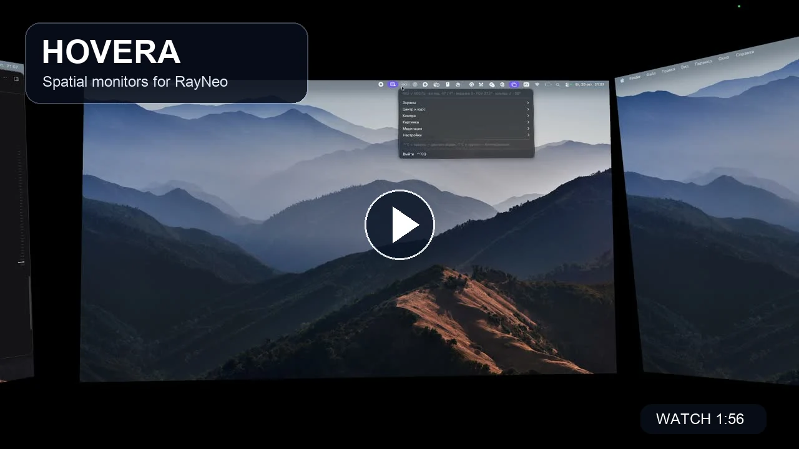

# Hovera

Floating virtual monitors for RayNeo AR glasses on macOS.

On a Mac, RayNeo glasses behave like a plain second display: the picture is glued to your face and turns with your head. Hovera creates several virtual displays and pins them in the room around you. Look left for mail, straight ahead for code, right for the browser. The cursor follows your gaze.

[Русская версия](README.ru.md)

> Unofficial project, not affiliated with RayNeo or TCL. The app is still called **RayDesk** inside; the rename is pending.

## Demo

[](https://github.com/user-attachments/assets/1672f470-9898-4518-8181-1e162efea922)

https://github.com/user-attachments/assets/1672f470-9898-4518-8181-1e162efea922

The 1:56 demo shows the view rendered for the glasses. [Download the MP4 (13.5 MB)](https://github.com/MegaBadCoder/hovera/releases/download/v0.3.0/Hovera-demo-720p.mp4).

## Features

- 2–4 virtual monitors placed around your head with 3DoF head tracking (~500 Hz IMU over USB).
- The cursor jumps to the screen you look at, including your MacBook's built-in display.
- Gather the screens in front of you, blank the MacBook display and keep the cursor out, or make the screen under your gaze the primary display for the menu bar, Dock and new windows.
- Move screens with ⌃⌥ + mouse drag; resize them and move them closer or further away.
- A compass (the glasses' magnetometer) keeps "forward" from drifting. It remembers the field separately for each gaze direction, so its orientation-dependent error does not push screens around.
- A compass indicator in the menu bar shows tracking state and changed magnetic fields; calibration and camera status appear in the app menu.
- Horizon grid and manual view calibration.
- Crisp text: virtual monitors run at 1920×1080 without HiDPI, and the picture is scaled down to the glasses' pixels with a bicubic filter plus light sharpening.
- Screens pinned to the wall using the MacBook camera: RayDesk learns the shape of the glasses on your face once (menu "Learn the glasses shape", turn your head for 20 seconds), then finds them in each frame and moves the picture with your head. Face points come from the MediaPipe face landmark model converted to CoreML; head rotation comes from the gyroscope, so tracking holds even where the face is no longer visible. Menu items "Head position from the glasses" and "Guided camera calibration".
- Background motion detection checks whether the MacBook camera moved before applying camera-based position and heading corrections; it can be toggled in the Camera menu.
- Adjustable picture stabilization (off, weak, medium or strong).
- Interface in English or Russian: menu → Settings → Русский / English. The choice applies at once and is remembered; the macOS permission dialogs follow the system language.

## Requirements

- macOS 15 or later.
- RayNeo Air-series glasses (USB `1bbb:af50`). Tested on one pair so far; reports from other models are welcome.
- Xcode 16 / Swift 6 toolchain to build.

## Download

Grab `Hovera-0.3.0-macOS-arm64.zip` from [Releases](https://github.com/MegaBadCoder/hovera/releases), unzip it and move `RayDesk.app` to Applications. Apple Silicon Macs only.

The latest source on `main` includes camera and status updates made after the 0.3.0 release. Build from source for those changes.

The app is not notarized yet, so macOS blocks the first launch: open it once, then System Settings → Privacy & Security → "Open Anyway". Or run `xattr -dr com.apple.quarantine /Applications/RayDesk.app`.

## Build and run

```bash
./build.sh
open RayDesk.app
```

Grant **Screen Recording** (to show the monitors) and **Accessibility** (to drag screens and move the cursor) when macOS asks. Log: `~/Library/Logs/RayDesk.log`. Tests: `swift test`.

The build is signed with your first "Apple Development" identity if you have one, otherwise ad hoc. An unsigned or ad-hoc build loses the Screen Recording permission after every rebuild.

## Controls

All shortcuts are ⌃⌥ (Control + Option) + key and work from any app.

- `R` — "forward" becomes where you look.
- `Space` — pick the screen under your gaze, it immediately centres on your gaze, then press again to place it where you look: aim and pick, move your gaze, press again. `G` — grab / release a screen without moving it.
- `⇧M` — move mode: `←` / `→` / `↑` / `↓` move the selected screen horizontally and vertically, `⇧↑` / `⇧↓` — closer and further.
- `↑` / `↓` — closer / further; `=` / `-` — bigger / smaller; `⇧↑` / `⇧↓` — tilt the screen back / forward (5° steps, up to 60°).
- `A` — arrange all screens in an arc, edge to edge. Default is a racing-style triple monitor: same size, upright, joined along the whole edge; menu → Screen joining switches to “facing you” (widths kept, each screen faces your eyes).
- `⇧G` — gather the screens in front of you. `⇧B` — blank the MacBook and keep the cursor off it; press again to restore it. `⇧P` — make the screen under your gaze primary, moving the menu bar, Dock and new windows into the glasses; press again to make the MacBook primary.
- `⇧←` / `⇧→` — turn the screen under your gaze by 2°; a joined side monitor swings around the shared edge like on a real stand.
- `⌘↑` / `⌘↓` — tilt all screens together.
- Mouse with ⌃⌥ held — drag a screen (its side edge sticks to a neighbour's edge when within 3°); scroll — closer / further; with ⌃⌥⇧ held, scroll tilts the screen.
- Menu → "Border around the screens" hides the screen borders, e.g. for films; a screen being dragged still shows its border.
- `D` — horizon grid; `C` — manual grid calibration: `←` / `→` forward, `↑` / `↓` horizon, `,` / `.` roll.
- `J` — force the cursor to where you look.
- `W` — move the active window to the screen you look at (it keeps its place on the screen and shrinks if it does not fit).
- `K` — compass calibration: about 25 s of slowly turning your head in all directions, including tilting to the shoulders.
- `Z`, then click — temporarily enlarge the selected screen 2×, center the clicked point in your view, and face the screen toward your eyes. Other screens are hidden; the enlarged screen stays anchored in space. Press `Z` again to restore the original layout or cancel point selection. The selection click is not sent to the application. Editing the layout ends zoom.
- `S` — look at the first screen and press, then look at the second and press again to swap their places. A thick border marks the first screen. Selecting it again cancels; looking between screens keeps the selection. Windows stay on their displays.
- `Shift+Z` — meditation mode: screens fade out, you float in space with calm generated music (see below).
- `[` / `]` — field of view; `9` / `0` — less / more motion prediction; `H` — hide the picture; `V` — record a video of the glasses to `~/Movies`; `M` — mark “I am looking at the middle screen”: logs how far the world has drifted without resetting anything; `Q` — quit.

## Gyro scale calibration

Worn on the head, a gyro that under- or over-counts turns by a few percent makes the screens lag behind your head and then slowly swing back into place. Menu → "Calibrate the gyro scale (glasses on the table)": stand the glasses on the table as if worn, press one temple against the edge of the laptop, wait for the status prompt in the menu bar, turn them two full turns and press the temple back against the same edge. The correction is saved. On the author's pair the gyro under-counted by 3.3 %.

## Meditation mode

⌃⌥⇧Z fades the screens out and surrounds you with space: stars, slowly drifting nebulae and a planet below. The sky is drawn procedurally on the GPU and stays put as you turn your head. Press ⌃⌥⇧Z again to get your screens back.

The sound is generated on the fly, no audio files: soft chords without a melody and ocean waves. "Neural effect" (menu → Meditation) adds a gentle 6 Hz pulse to the music volume, similar in spirit to brain.fm; off / low / medium / high. "Breathing" shows a glowing ring in front of you: 4 s inhale, 6 s exhale. The cursor does not follow your gaze while meditating.

## How tracking works

- Gyroscope integration, tilt corrected by the accelerometer (complementary filter).
- Worn on the head, the gyro's zero point wanders by up to 0.5°/s and jumps when you adjust the glasses. Only an absolute reference can hold "forward", so the compass gently pulls the heading toward the magnetic field.
- The compass is off by up to ~14° when you look to the side. Hovera keeps a separate field reference per 15° gaze sector and compares the compass only with what it saw in the same head orientation.
- Without a compass calibration, the gyro's zero point is learned in moments of stillness.

Tests replay real recorded head motion and check jitter, lag and drift in world axes.

## Recording sensor data

For debugging tracking you can record raw IMU data to `~/Library/Logs/RayDesk-imu` (30-minute files, the last 4 are kept, up to ~300 MB):

```bash
defaults write local.raydesk recordIMU -bool true
```

## Limitations

- Without camera-based head position tracking, placement is rotation-only (3DoF). Camera tracking estimates limited head movement; it is not room-scale 6DoF tracking. Press ⌃⌥R to recenter if the view shifts.
- Uses the private `CGVirtualDisplay` API to create displays.
- Not notarized yet.

## Acknowledgements

Protocol details and ideas came from these open projects:

- [RayNeo-Air-3S-Pro-OpenVR](https://github.com/verncat/RayNeo-Air-3S-Pro-OpenVR)
- [ar-drivers-rs](https://github.com/badicsalex/ar-drivers-rs)
- [XRLinuxDriver](https://github.com/wheaney/XRLinuxDriver) and [Breezy Desktop](https://github.com/wheaney/breezy-desktop)
- [Fusion](https://github.com/xioTechnologies/Fusion)
- [XRealDesk](https://github.com/PlunderStruck/XRealDesk)
- [MediaPipe Face Landmarker](https://ai.google.dev/edge/mediapipe/solutions/vision/face_landmarker) — face landmark network (Apache 2.0), converted to CoreML by `tools/facemesh-coreml`

## License

[MIT](LICENSE)
